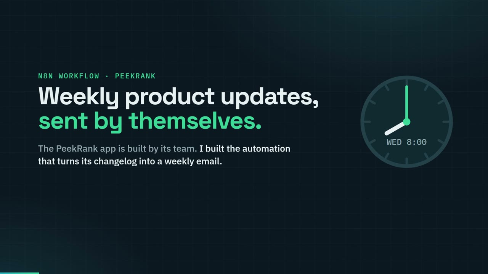
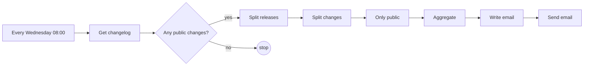

# PeekRank weekly changelog email (n8n workflow)

An n8n workflow that, every Wednesday at 08:00, asks the PeekRank API for last week's product changes, keeps only the public ones and sends a single summary email.

**PeekRank is built by its own team. This repository only contains my part: the automation.** No PeekRank code, data, keys or internal addresses are included.

- 🎥 **Animated walkthrough (35 s):** [`docs/peekrank-workflow.mp4`](docs/peekrank-workflow.mp4) · also on my portfolio: https://paula-lopez.vercel.app
- 👤 **Author:** Paula López · [LinkedIn](https://www.linkedin.com/in/paulaMLJ)

## How it works

| # | Node | What it does |
|---|---|---|
| 1 | Schedule Trigger | Starts the workflow every Wednesday at 08:00 (Madrid time). |
| 2 | HTTP Request | Asks the PeekRank API for the changes from last Monday to Sunday. Retries up to 3 times. |
| 3 | If | Stops when there are no public changes, so no empty email is ever sent. |
| 4–5 | Split Out ×2 | Splits the response into releases, and each release into single changes. |
| 6 | Filter | Keeps only changes marked as public. |
| 7 | Aggregate | Gathers them back into one list. |
| 8 | Code | Writes the subject and the body, grouped by release, with dates in Madrid time. |
| 9 | Send Email | Sends the summary. |

**Dates:** `since` is last Monday (included) and `until` is this Monday (not included), so each run covers exactly one week: nothing is lost or repeated, even if it runs twice.

## Testing

Tested end to end with real data before going live: 2 releases → 6 changes → 4 public → 1 email. The "no public changes" branch was tested with mock data and stops at the If node.

## Using the workflow

1. Import [`workflow/peekrank-changelog.json`](workflow/peekrank-changelog.json) into n8n.
2. In **Get changelog**, set your own API URL and a *Header Auth* credential with your key. Keys never go inside a node.
3. In **Send email**, set an SMTP credential and the from/to addresses.

What was removed from this copy: the API host and path, credentials, and every email address. The field names in the expressions match the API response the workflow was built for.

## Animation

The video is a web page rendered frame by frame: [`animation/anim.html`](animation/anim.html) (all motion is driven by `render(t)`), recorded with [`animation/grabar.py`](animation/grabar.py) through the Chrome DevTools protocol, with music generated by [`animation/musica.py`](animation/musica.py). The screenshot of the real workflow used in one scene is not included.

## Credits

Built in n8n with AI assistance, from the PeekRank team's specification.
